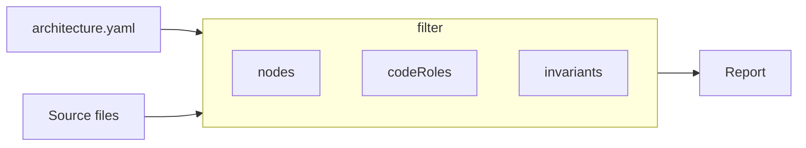

# follow-architecture

ESLint rule + CLI that validates code against a declarative architecture. The plugin knows nothing about your project — everything (paths, names, rules, fixes) lives in `architecture.yaml`.

The plugin is 100% generic. It collects **facts** from the AST via ts-morph and evaluates **filters** (Keystone-GraphQL-filters style) against them. There are no named rule kinds and no semantic predicates inside the plugin — all rule semantics live in the YAML.

Three chunks are what you AUTHOR, and each is a question asked of the same source
files — they do not mix:

| chunk | YAML key | folder | answers |
| --- | --- | --- | --- |
| nodes | `nodes` | [nodes/](nodes) | where files may live, what names they may have, and which role each child holds |
| codeRoles | `codeRoles` | [code-roles/](code-roles) | what a declaration *is* (store model, factory, pure function, …) and what may be done with it — never where it lives |
| invariants | `invariants` | [invariants/](invariants) | what a file may contain |

`aliases` maps import sources to paths so the three can resolve imports; it is
the only other key in the file.



Everything else in this repository is the engine that answers those questions —
it carries no project knowledge.

## Quick start

Pick your runner:

<details open>
<summary><b>bunx</b></summary>

```sh
bunx follow-architecture --config architecture.yaml --out reports/follow-architecture.md
# exit 1 when findings exist (CI):
bunx follow-architecture --config architecture.yaml --check
# interactive, self-contained HTML overview (structure · roles · graph · findings):
bunx follow-architecture --config architecture.yaml --overview reports/architecture-overview.html
```

</details>

<details>
<summary><b>pnpm dlx</b></summary>

```sh
pnpm dlx follow-architecture --config architecture.yaml --out reports/follow-architecture.md
# exit 1 when findings exist (CI):
pnpm dlx follow-architecture --config architecture.yaml --check
# interactive, self-contained HTML overview (structure · roles · graph · findings):
pnpm dlx follow-architecture --config architecture.yaml --overview reports/architecture-overview.html
```

</details>

<details>
<summary><b>npx</b></summary>

```sh
npx follow-architecture --config architecture.yaml --out reports/follow-architecture.md
# exit 1 when findings exist (CI):
npx follow-architecture --config architecture.yaml --check
# interactive, self-contained HTML overview (structure · roles · graph · findings):
npx follow-architecture --config architecture.yaml --overview reports/architecture-overview.html
```

</details>

As an ESLint rule (flat config):

```js
const { flatConfig } = require("@md-code/follow-architecture");
module.exports = [...flatConfig(require("./architecture.yaml"))];
```

## `architecture.yaml`

```yamlc
# import-source → repo-relative path (for resolving imports in facts)
aliases:
  backend: apps/backend

# folder tree: where files may live
nodes:
  - slug: backend          # unique id, referenced by parent / children
    name: apps/backend     # path segment (or prefix); {name} placeholders capture segments
    parent: root
    closed: true           # a file directly inside must match one of children
    report:                # finding text for "file does not belong here"
      message: "…"
      fix: "…"
    children:
      - index.ts
      - "{kebab-case}.ts"  # name template; {kebab-case} matches kebab-case text
      - name: "{kebab-case}"
        forbidden: true    # a shape that must NEVER exist
        report: { message: "…", fix: "…" }
      - name: store.ts
        required: true     # without it the folder is not this node at all

# what a declaration is: a LIST of roles, first `infer` filter that matches wins
codeRoles:
  - slug: storeModel
    name: store model
    # The chain roots that REACH this role without an import
    # (mobx-state-tree's getRoot/getParent). Each entry is structured:
    # `kind` is the base shape of the chain — call / identifier / methodCall —
    # and `segments` is the callee (or base + leading properties).
    # Per-role on purpose: different roles are reached differently.
    infer:
      - kind:
          own: { is: { equals: VariableDeclaration } }
          initializer:
            is: { in: [CallExpression, NewExpression] }
            origin: { equals: "t.model" }
    where: [{ node: feature-store }]   # where it may be declared
    actions:
      import: { where: [storeModel] }  # who may import it

# what a file may contain
invariants:
  - id: no-any
    where: ["**/*.ts"]          # globs or { node: slug }; empty/omitted = all files
    ignore: ["**/*.test.ts"]    # same entry interface: glob or { node: slug }
    when:                              # optional gate: a plain filter over the file facts
      roles: { any: { equals: orchestrator } }  # e.g. "a role is present"
    infer:                      # a finding when a filter MATCHES the facts
      - kind:
          descendants:
            any:
              is: { equals: AnyKeyword }
    # "must be true" is the same filter under `not:`
    # - not: { location: { files: { contains: store.ts } } }
    report: { message: "…", fix: "…" }
```

The yaml describes **what the code must look like** — it carries no scan scope. Where the tool looks is a tool concern, set separately:

- **CLI** — `--files <glob>` (files to scan; default: the whole tree), `--ext <.ext>` (repeatable, added to the built-in source extensions), `--ignore <glob>` (repeatable, file globs skipped), `--ignore-dir <name>` (repeatable, folders not entered).
- **ESLint rule options** — `{ config, exts?, ignoreDirs?, ignores?, include?, exportPath? }`: `exts` (added to the built-in source extensions), `ignoreDirs` (folder names not entered, added to the built-in `node_modules`, `.git`, `.vscode-test`, `out`, `dist`, `build`, `coverage`), `ignores` (file globs skipped), `include` (only these globs are checked) and `exportPath` (where the run writes its HTML overview — the same self-contained report `--overview` produces; default `reports/architecture-overview.html`, `false` turns it off). The export file is accumulated across every linted file and written when the run ends, so a plain `eslint <dirs>` run leaves the whole report on disk.
- The built-in extension list (`.ts`, `.tsx`, `.js`, `.jsx`, `.mts`, `.cts`, `.vue`, `.svelte`) is only a default: `--ext` / `exts` add to it.

## Placeholders

A `{…}` in a path pattern is a **capture**, and it is written IN the convention it
asks for — the convention is read off the name, so there is no list of known ones:

| write | matches |
| --- | --- |
| `{kebab-case}`, `{feature-name}` | `todo-list` (any `-`-joined lowercase name) |
| `{snake_case}` | `todo_list` |
| `{UPPER_CASE}` | `MAX_RETRIES` |
| `{FEATURE-NAME}` | `TODO-LIST` |
| `{camelCase}`, `{myCase}` | `todoList` |
| `{PascalCase}`, `{Name}` | `TodoList` |
| `{Mixed_Name}` (states no convention) | anything but `/` — it captures and enforces nothing |

A placeholder may share a segment with literal text, so a test file is declared
next to the code it tests: `{kebab-case}.spec.ts` matches `todo-list.spec.ts` and
not `todoList.spec.ts`; inside a segment, dots and other text are literal.

## Nodes

A **node** is a folder (or folder prefix) in the tree. Nodes reference each other by `slug`; the path of a node is its `parent`'s path + its `name`.

- `slug` — unique name, used as `parent` by children.
- `name` — the path segment. Placeholders capture path segments (e.g. `{kebab-case}` in `apps/backend/features/{kebab-case}`) and are available in reports. See **Placeholders** below.
- `parent` (optional) — the `slug` of the containing node. No `parent` = root.
- `closed` (optional, default `false`) — when `true`, a file directly inside must match one of its `children`; otherwise it gets the node's `report`.
- `report` (optional) — the finding for "file does not belong here".

- `children` (optional) — allowed names inside the node. Each entry is either:
  - a **string** — a name template (`{kebab-case}`, `*`, `?` work; a name without an extension is a folder, with an extension is a file, and a name may mix both — `{kebab-case}.spec.ts`);
  - an **object** — `{ name, forbidden?, required?, report? }`. `forbidden: true` names a shape that must **never** exist; `required: true` names a shape that must **always** exist.

`required` is what makes a folder an instance of the node. A node whose template matches a folder that lacks a required child is not that folder's node: the folder is reported as "not a `<node>`" (once per folder, not per file) and is otherwise treated as outside the architecture — no role destinations are invented inside it. This is how a folder that merely *looks* like a feature is caught, with no per-folder rule to write.

A node with no `children` is **open** — anything inside is fine. The deepest matching node wins.

A node carries **structure only**: `slug`, `name`, `parent`, `children`, `closed`, `report`, `role`. Any other key is an error, not a silent no-op, so a YAML that still uses a retired key fails loudly instead of claiming a rule nobody enforces.

A child is a NAME (`actions`, `store.ts`, `{kebab-case}`) or a spec. The spec may
add what the child is FOR:

```yaml
children:
  - store.ts                                   # just a name
  - { name: actions, role: action }            # this folder IS that code
  - { name: store.ts, role: [storeModel, sharedTypes] }  # a file may be several roles
  - { node: backend-feature-actions, role: action }      # borrow another node
  - name: actions                              # required: this folder is not the node without it
    required: true
    report: { message: "…", fix: "…" }
```

`role:` on the node itself means the same for the whole node: `role: sharedTypes`
on `packages/types` says every file there is that code — the "whole folder is a
codeRole" case, written once. **This is the only place a location is stated**:
the tree owns WHERE, a codeRole owns WHAT. Nothing else in the config names a
folder for a role, and `codeRoles[].where` is an error.

### A role belongs to a piece of code, not to a file

`infer` runs over the declarations in a file — functions, methods, classes,
variables — and every one of them carries its own role. One file may therefore
hold several roles at once: a `store.ts` is the store, the accessors that hand
it out and the views beside it; a `settings.ts` is a view (`getHost`) next to an
action (`setHost`). `role: [a, b]` on a node says which roles may be declared in
that folder, and a finding always names the PIECE it judges (`setHost` is an
action) together with the relation it broke.

A piece no role describes is granted nothing: every relation it makes is
refused, and the finding says so by naming that piece. A piece that reaches
nothing is not asked — silence there is the absence of a question, not
permission.

### `where` — one mechanism, used everywhere

A node is STRUCTURE only: paths, allowed children, `closed`, and which role its
code is. A codeRole carries no location at all — it says WHAT code is; the node
that holds it says WHERE:

```yaml
nodes:
  - slug: feature-actions
    name: actions
    parent: "{kebab-case}"
    role: action                                     # WHERE that code lives

codeRoles:
- slug: action
  infer: [{ location: { node: feature-actions } }]   # WHAT it is
  report: { message: "…", fix: "…" }                 # said when it is misplaced

  actions:                                           # WHAT MAY BE DONE WITH IT
    import:
      where: [storeModel]                            # who may import it
    usage:
      where: [action, orchestrator]                  # who may call it
      scopeAccess:                                  # …reaching it without an import
        - { kind: function, segments: [getRoot] }   # getRoot(self).x
        - { kind: object, segments: [self, root] }  # self.root.x
        - { kind: method, segments: [parent, get] } # parent.get("n").x
    mutation:
      where: [action]                                # who may write it
```

- `actions` is an open map: the key IS the action name (`import`,
  `export`, `call`, `mutate`, `read`, … or your own). Declaration is not
  an action here — it is the role-level `where`. The rule does not
  enumerate them — for each kind it asks the fact layer which source→target
  edges exist, finds the target's role, and applies that action's `where`.
  A declared action nobody can verify is reported, never silently ignored.
- `where` is the ONE way to say who/where — the same mechanism invariants use
  for their `where` / `ignore` (`utils/where.js`, imported by both, given the
  same facts): a list of roles (`{ role: x }`), nodes (`{ node: y }`) or filters
  (`{ role: x, same: true }` = same node instance). Paths themselves live in
  `nodes`, so a `where` never restates a folder. The same entry means the same
  thing in both places — action and invariant gate — because it is literally
  the same matcher:

  An entry may add `via: import`: this actor *holds* the target from an import
  instead of reaching it through the object tree (a controller calls
  `getStore().file.readFile()`, an action walks `getRoot(state)`), so the
  target's `scopeAccess` chains are not its way in — and the picture stops
  claiming they are.

  ```yaml
  # action: may this role's code be IMPORTED / CALLED / WRITTEN by…
  actions:
    mutation: { where: [{ role: action }, { role: orchestrator, same: true }] }
  # invariant: does this rule apply to this file — same syntax, same facts
  invariants:
    - id: store-size
      where: [{ role: storeModel }]        # a role reference
      infer: [{ lines: { gt: 400 } }]      # the SAME key a role uses
  ```

  There is no "action kind" list to learn: an action is checked against the
  fact class of the same name, and any other name can name its fact class with
  `of:` — `emit: { of: call }`, `subscribe: { of: call }`. An event-driven
  design gets its own vocabulary with no engine change.
- `scopeAccess` lists the chain roots through which the role's code is reached
  without an import, with the SHAPE of the root spelled out: `function`
  (`getRoot(self).x`), `object` (`self.root.x`, `global.x`), `method`
  (`parent.get("n").x`).
- A role has **no home of its own**. Where its code may be declared is stated by
  the tree — `role:` on a node, or `role:` on a node child. Code of the role
  declared outside every such place is reported with the place it belongs. A
  role nobody gives a home may live anywhere the tree allows, so its misplacement
  is never reported (and its card in the overview says so).
- An action carries exactly `where`, `of` and `scopeAccess`. Anything else
  (`byName`, `report`, `allowedFrom` …) is an error rather than a rule the
  config believes it declared, and so is `of:` naming a relation the fact layer
  cannot produce (`import` / `export` / `call` / `mutate` / `read` / `typeImport`).

## Code roles

A **candidate** is any function-like node (declaration, expression, arrow, method, accessor), any **class**, or a variable declaration. A class is a candidate so a decorator/DI design is describable without engine support: its facts carry `kind.decorators`, `extends`, `implements`, `members` (each with its own decorators) and `constructorParams`. Nothing in the engine knows what `Component`, `Injectable` or `NgModule` mean — the YAML does.

`.vue` / `.svelte` single-file components are parsed too: only the `<script>` block is handed to the parser and every other line is blanked, so reported line numbers still match the file in the editor. For each candidate the plugin collects raw facts (below) and assigns the **first** role (in YAML declaration order) whose `infer` filter matches.

- `infer` — an AND-list of filters on the candidate's facts. A role without `infer` is never inferred. An entry may be a bare STRING naming another role: `infer: [action, { lines: { gt: 5 } }]` means "code that is an action AND longer than 5 lines" — roles compose without any extra keyword. Filters may nest `and` / `or` / `xor` / `not` to any depth, so a role can describe a shape as precisely as needed:

  ```yaml
  infer:
    - and:
        - kind: { own: { is: { equals: ArrowFunction } } }
        - or:
            - calls: { any: { targetRole: { equals: action } } }
            - kind: { descendants: { any: { is: { equals: AwaitExpression } } } }
        - not:
            calls: { any: { targetRole: { equals: pureFunction } } }
  ```
- `where` (optional) — the role's HOME: where its code may be declared. Omitted = the `location` filters of `infer` (the common case, written once). Code of the role declared outside every home is reported with the place it belongs.
- `actions` (optional) — an open map of what may be done with code of this role and by whom: `import`, `export`, `call`, `mutate`, `read`, `typeImport`, or any name with `of:`. Each entry is `{ where, of?, scopeAccess? }`.

## Invariants

An **invariant** is a per-file rule. Fields:

- `id` — unique name.
- `where` (optional) — the SAME `where` the code roles use: globs (with the placeholders below), `{ node: slug }`, `{ role: slug }` (a bare string naming a role works too), or a filter over the file facts (`{ imports: { any: … } }`). Empty/omitted = all files.
- `ignore` (optional) — the same, inverted: the invariant does not apply there.
- `when` (optional) — a gate: a plain filter over the file facts (the same filter language as `rule`/`must`, run through the shared `matches` engine). The file facts include `roles` (the flat list of role names present) and `candidates` (the role-enriched candidate facts, each carrying `role`, `parentRole`, and `calls[].targetRole`). Example: `when: { roles: { any: { equals: orchestrator } } }` gates on "an orchestrator is present"; `when: { candidates: { any: { role: { equals: pureFunction }, parentRole: { equals: orchestrator } } } }` gates on "a pure function nested in an orchestrator". Omitted = no gate.
- `infer` (optional) — list of filters; a finding when a filter **matches** the file facts. **The same key and the same filter language as a codeRole's `infer`** — only what a match means differs: in a role it says "this code IS that role", here it says "this file breaks the rule". The filter is asked of the **file** first; when the file answers, the finding is about the file. When it does not, the SAME filter is asked of every **candidate** in that file, and the matching candidate supplies the `{what}` / line of the finding. There is no list of "which facts exist where" — the facts answer for themselves. The report can name the offending values (`{violations}`): for a top-level field written as `{ every: <sub> }` (also behind a `not:`), the items of that fact's list that fail it.
- That is the ONLY check. "This must be true" is the same filter under `not:` — the language already has `and`/`or`/`xor`/`not` at any depth, so a second key would be a second way to say one thing.
- `dedupeBy` (optional) — WHERE the findings are counted, written with the same `where` entries the roles use: `[{ node: backend-feature }]` reports once per feature folder, a glob once per matched folder, a filter once per the file's own folder. File-level findings are then reported once per distinct place across the run, so a per-folder rule fires once per folder instead of once per file.
- `report` (optional) — the finding text. An invariant with a `report` and no checks of its own is its own finding (it applies to every matching file).
- `children` (optional) — nested invariants, evaluated with the same file facts.

Old keys fail with the name to use instead: `except` → `ignore`, `forbid`/`rule` → `infer`, `assert` → `infer`, `must` → `infer: [{ not: … }]`. None of them had a meaning of its own: `assert` was `infer` with the offending values named, `must` was the same filter read backwards.

## The filter engine

Every `infer` / `where`-by filter uses one grammar ([entities/queries.js](entities/queries.js)). A filter is:

- an **object of entries** — AND of all entries;
- a **list of filters** — AND of all sub-filters;
- `null` / omitted — always passes.

Each entry is either an **operator** or a **field** of the item — one field at a time, on every fact:
`{ name: { equals: "x" } }` → `item.name` must pass it; `{ kind: { own: { is: { in: […] } } } }` → `item.kind.own.is` must. There is no shorthand for a structured fact.

Scalar operators: `equals`, `not`, `lt`, `lte`, `gt`, `gte`, `in`, `notIn`, `contains`, `startsWith`, `endsWith`, `isSet`, `setEquals`, `matches`.

List operators (list values only; a missing/non-list field simply fails the filter): `length`, `every`, `any`, `none`, `where` (`{ filter, by }` — narrows the list, then applies `by`).

Composition: `or` — a list of filters; passes when **any** sub-filter passes.

`$`-prefixed values reference another fact in scope: `{ equals: "$name" }` compares the field to the candidate's own `name`.

## Facts

A relation is a **runtime** dependency: `import type` is not one (nothing is bound at runtime), so an adapter may name a type of the code it must not import. Type-only imports are a relation of their own — `typeImport` — so a project can allow one and forbid the other: `import` says "this code runs against that file", `typeImport` says "this code names a shape from it".

**File facts** (the target of file-level invariant filters): `lines` (the file's lines, as **one array** — `lines[0]` is the first, `lines.length` the count), `imports` (one list for every way a module is brought in: `[{form, source, resolved, typeOnly, named, defaultName?, namespaceName?, line, piece}]` — `form` is `statement` / `require` / `dynamic`, `named` carries local binding names, `resolved` is the repo-relative path after alias expansion, `piece` names the function a `require` sits in), `exports` (one list for every way code leaves the module: `[{form, named, from, source, name, line, piece}]` — `form` is `named` / `namespace` / `star` / `default` / `equals` / `commonjs`), `location` (WHERE the file is — the one place fact: `location.path`, `location.dir`, `location.fileName`, `location.files` — the folder's own files, so the count is `{ location: { files: { length: { gt: 7 } } } }`), `kind` (the file's own node and every node below it — see the `kind` fact), `candidates` (the function-like / variable-declaration facts, each role-enriched), `roles` (the flat list of role names present).

**The `kind` fact** — one shape for every structural question about a node, so a rule never needs a second vocabulary. `kind` holds six facets, and every facet answers with the SAME descriptor `{ is: <ts-morph kind>, …extras }`:

| facet | is |
| --- | --- |
| `own` | the node itself |
| `parent` | its syntax parent (may be a `Block` or a `VariableStatement` — syntax, not meaning) |
| `ancestors` | every enclosing node up to the file |
| `children` | its direct children |
| `siblings` | its siblings |
| `descendants` | everything below it, flat (`depth: 0` = a direct child; extras: `snippet`, `nested`, `type` on `as` expressions, `members` on object literals) |
| `initializer` | for a declaration, the value it is initialised with: `{ is, origin, members }` (`origin` is the leftmost identifier chain: `t.model` in `t.model({…})`, and `is` is `CallExpression`) |

Every facet is the same descriptor — `{ is, name, line }` plus what that node has on top — and they all take the same filters — `{ is: { equals: "ClassDeclaration" } }`, `{ is: { in: [...] } }`, a nested filter, everything in `entities/queries.js`. A structured fact is always addressed through its fields — `kind: { own: { is: { in: [...] } } }`, `kind: { parent: { is: { notIn: [...] } } }` — so `kind` never looks different from any other fact. Because the facets are one list of node descriptors, `kind.initializer` is NOT a separate concept: it is the same descriptor, one level down.

**Candidate facts** (one entry per function-like node / class / variable declaration) — a piece of code is described with four things and nothing else:

| fact | what it holds |
| --- | --- |
| `location` | where it IS: `location.path` (the file) and `location.piece` (the piece it is nested in — `null` = module scope). `{ location: { piece: { isNull: true } } }` reads "at module scope", and `{ location: { node: … } }` matches the path |
| `lines` | the lines it spans, as ONE array: start, everything inside, end (`lines[0]`, `lines.length`) |
| `parameters` | `[{ name, type, typeFile }]` — `typeFile` is the file that declares the parameter's type, resolved by the checker |
| `calls` | `[{ kind, origin, action, module, target, forwardsAllParams, targetRole }]` — running somebody's code |
| `assignments` | `[{ line, target, method, value, via, module, onThis, type, param, local, relation }]` — every write, in one fact. `via` is `assign` / `call` / `delete` / `freeze` / `seal`; `value` is the root identifier written into; `module` is the other module whose value it is; `onThis` marks `this.x`; `type` is the file declaring the written value's type; `param` says the root is one of this function's parameters. `relation` is the ONE classification of the write — `mutate` (somebody else's value), `assign` (a value that was handed in or is declared in the repo) or `null` (the piece's own local, which no role has a say in) |
| `returns` | `[{kind, exprKind, origin, members}]` — the value it yields |
| `kind` | what it is, what is around/below it, and how it is SPELLED: `own` / `parent` / `ancestors` / `children` / `siblings` / `descendants`, plus `modifiers` (`["export", "abstract", "const"]` — the words as written, for every kind of declaration), `decorators` (`[{ name, full, line }]`), `assertion` (`as const` / `satisfies X`) and `disposable` (`using`) |
| `name`, `kind`, `role` | what it is CALLED, what it IS, and the role it got |

Plus, for a declaration: `exported` (is it written with `export`), `mutable` (may the binding be reassigned — `let`/`var`), `extends`, `implements`, `members`, `constructorParams` for classes, `references` / `implementations` (the checker's answer, not the tree's), and `file` (the facts of the file it lives in, so a role can ask `{ file: { imports: { any: { source: … } } } }` — "this function depends on the IDE API, so it is a host adapter, not a helper").

Everything a piece DOES is a **relation** (`entities/kinds.js`), and the eight relations are the whole vocabulary: `import`, `export`, `declare`, `call`, `mutate`, `assign`, `read`, `typeImport`. There is no second way to say "it writes" or "it is exported".

A call's `target` is a **location**, the same interface `allowedFrom` uses: `{ path, name }`, where `path` is the module the callee was imported from (only bare-identifier calls carry one — `store.doX()` names a member, not an imported symbol). So a call destination is addressed exactly like anything else in the architecture:

```yaml
# "a function that calls something living in the actions node"
infer:
  - calls:
      any:
        target:
          location: { node: backend-feature-actions }
```

`targetRole` is the same question answered in role vocabulary: the role whose home covers the target's location — the `role:` a node declares for that path. An ambiguous location yields `null` — the engine never guesses.

`nested` is set on function-like / loop descendants: `true` when nested inside another function-like node. A descendant is the same descriptor as every other `kind` facet, one level deeper (`depth`).

## Report

`report` is `null`, a string, or `{ message, fix }`. Both fields support multiline Markdown. `{name}` placeholders are substituted: path vars (`{file}`, `{basename}`, `{dir}`), every scalar of `location` (`{fileName}`, `{files}`), captures from `where` / node names, and match context (`{what}` — the matched candidate's name, `{snippet}`, `{lines}`, `{files}` — an array fact reports its length, …).

### What a finding says

A finding is written for someone who has to ACT on it, so it carries the same
information the graph does — never a choice between two half-answers:

| Part | What it names |
|---|---|
| the message | the offending line, the rule that fired, and everything the rule DOES allow — a closed folder lists its declared children, an action lists the roles and the concrete folders that may do it, a feature lists the files it must own |
| the destination | when the offending code has a role with a declared home, that home resolved for this file (`packages/utils`, `apps/backend/grammar/controller.ts`), so "move it" means one path, not "somewhere" |
| the mechanisms | for an action with `scopeAccess`, the chains that may reach the same code WITHOUT an import — `getRoot(…)`, `self.root`, `parent.get(…)` — the same words the config uses |
| `How to fix` | one instruction per offending line, naming the exact file or folder to move to — and **nothing at all** when the architecture cannot prove a destination: then the message alone says where this code must not live |

Which home answers is decided, not guessed: a home in the file's own BRANCH wins
(`src/alpha/actions/**` says nothing about a file in `src/beta`; a
`{kebab-case}` segment matches the file's own instance), and among those the
closest one. When no home is in the file's branch — a role allowed in several
unrelated packages — the home declared FIRST answers, so **the order of the
nodes that declare a role is its priority list**: put the canonical home first,
the permissive ones (examples, tests) last.
| the config file | every instruction names the file the architecture was actually loaded from (`architecture.yaml`, or whatever `--config` pointed at) — never a hardcoded default |

When the architecture genuinely has no answer (a role with no declared home, in
a folder the tree does not declare), the finding says exactly that and names the
single edit that gives it one — it does not offer an "either … or".

### Where the wording lives — `report/errorTypes/`

The engine observes and decides **facts**. The report turns facts into
**language**, once, for every consumer (the CLI text, the linter message, the
interactive overview). No module outside `report/errorTypes/` writes a sentence
about a finding.

```
report/errorTypes/
  index.js            public surface: describe(), renderToken(), ids
  decision-maker.js   the only decision maker: which kind of finding, what to say,
                      what can be done, and WHERE the code belongs
  vocabulary/
    ids.js            the ids both sides use (the report and the picture)
    verbs.js          "imports" / "import" / "mutation"
    phrases.js        a fact → a phrase, a subject, a reason
    places.js         role → box, name → node, a role's declared home
  types/
    wrongAction.js    a relation the architecture forbids
    wrongPlacement.js the code is in the wrong place (move, or split)
    unknownRole.js    nothing declares this kind of code here
    fileContents.js   the finding judges the file itself
  codes/
    structure.js      structure.* — "this entry does not belong in this folder"
```

### Where a move goes — `decision-maker.js` → `decide()`

A destination is a **decision**, not a lookup: it is decided by the **code role**
and confirmed by the tree. The percentage is a `0..1` confidence:

| Source | Question it answers | Weight |
|---|---|---|
| `declared` | does the tree call this file that role (its owner node's roles)? | 0.45 |
| `inferred` | did the engine infer that role from the code itself? | 0.30 |
| `named` | does a home of that role name this file? | 0.13 |
| `hostable` | can a real node instance host that home today? | 0.07 |
| `branch` | is that home in the file's own top branch? | 0.05 |

`permits` is **not** a weight — it is a **gate**: the rule is "everything not
allowed is forbidden", so a place where the relation is still forbidden is not a
destination at all, whatever the other signals say. A permission says the move
would be legal; it never says the move is right (`testCode` may call an action,
and that says nothing about where production code belongs).

A candidate also needs a known code role (`declared` or `inferred`) and at least
two sources (`MIN_EVIDENCE`) with **confidence ≥ 0.5**. When nothing qualifies,
no move is offered — the finding's repair is the removal, which is the honest
answer for "this role may not do this here".

One output format for every candidate, so the text and the picture read the
same numbers:

```js
{ role, node, path, confidence, tier, reason, signals, contributions,
  evidence, thresholds, weights }
```

Each type answers three questions and nothing else:

| Export | Question |
|---|---|
| `classify(ctx, places)` | is this finding of my kind, and what are the facts? |
| `message(story, ctx)` | the sentence to print — `null` keeps the engine's |
| `fixes(story, ctx)` | **a list** of repairs, cheapest first |

`fixes` is always a list because a broken rule usually has more than one honest
answer. A forbidden relation, for example, can be repaired by removing the
usage, by moving the code into a role that may do it, or by widening the rule in
the architecture — printing only the first one is how a report ends up saying
"Delete it." about a file that is perfectly placed.

**The engine emits tokens, not prose.** A refused relation travels as

```js
{ code: "relation.forbidden",
  fact: { kind: "typeImport", resolved: "…/document/type.ts" },
  subject: { pieces: [], roles: ["constants"], plural: false },
  why: { code: "allowed", roles: ["storeModel", …], targetNode: "sharedTypes" },
  via: null }
```

`phrases.js` renders the sentence from it, `wrongAction.js` renders the
repairs, the picture renders the arrow. The node→node edges carry the same
structured `fact` (no words), so the AST layer cannot disagree with the report
about what the code did.

`report/user-report/src/graph/` is the picture side, one representation per id —
`representation/wrongAction.js` (one crossed-out arrow, no marks on the boxes),
`wrongPlacement.js` (✕ here, ✓ there), `unknownRole.js` (one crossed box),
`fileContents.js` (the box, unmarked). `graph/decision.js` picks the one that
draws the story; `graph/ids.js` and `graph/words.js` import the ids and the
verbs from `report/errorTypes/`, so a label can never drift from a sentence.

### The modules, in one table

| Path | What it owns |
|---|---|
| `entities/ast/` | reading code: imports, calls, writes, declarations → **facts** |
| `entities/kinds.js` | a fact → an **edge** (`{ path, line, piece, role, fact, what }`) |
| `entities/tree/` | **where** files may live: `build.js` (nodes → path variants + role homes), `match.js` (a path → its node, and whether that node is real there), `entries.js` (walking a path, reporting undeclared entries) |
| `nodes/` | `children.js`, `homes.js` (where a role lives), `similar.js` |
| `nodes/finally/` | the built-in structure rule, four questions in four files: `required.js` (is this folder an instance of its node?), `queries.js` (does this file match a child's query?), `relations.js` (does this file reach code it may not?), `emit.js` (one finding per decision) |
| `report/errorTypes/` | **the words**: message, repairs, and the ids the picture uses |
| `report/user-report/` | the interactive overview: data → JSON → React |


### `--overview` (interactive HTML)

`--overview [path]` writes one self-contained HTML file (no server, no network, no sidecar assets) that renders the architecture as a browsable model:

| Screen | What it answers |
|---|---|
| **Overview** | counts, findings by category, orphan files, the most important violations |
| **Architecture tree** | every declared node, the roles that may live in it, the arrows that touch it, and its findings as links. Each row carries a coloured dot per action it takes part in — the same colours the Graph uses |
| **Graph & code roles** | the roles list and the selected role's card on the left (how it is inferred, a real example, what may be done with it); the canvas on the right draws that role's boundary as **folders** — boxes are declared nodes, arrows are the actions the role declares, one filter button per action (`all` by default). Clicking a folder opens its boundary in both directions |
| **Code roles** | how each role is inferred, where it may live, what may be done with it, and real matches from this repo with code snippets |
| **Invariants** | each cross-cutting rule rewritten as plain conditions (`lines > 200`, `rule ≠ action`), with `where` / `ignore` named by kind |
| **Findings** | every violation with its message, **the boundary it crossed**, why it matters, and the fix |

The graph is **folder → folder**, never role → role: the boxes are the declared
nodes (labelled by path). Every action reads the same way: **`a ──kind──▶ b`**
means *code in `a` is `<kind>`ed inside `b`* — the arrow follows the dependency,
from the code that is imported or used into the code that imports or uses it. So
`store.ts ──import──▶ controller.ts` is the controller importing the store,
`store.ts ──call──▶ actions` is an action reading the store, and
`feature/store.ts ──import──▶ store.ts` is the main store composing the feature
one. The edge exists because `codeRole.actions.<kind>.where` says who may do it
and the target role's `where` says which folders that code lives in. Selecting a
role draws every arrow it takes part in, from either side: what may be used
inside its code, and where its own code may go.

Nothing on the canvas overlaps another thing on the canvas. An arrow never
crosses a box: a step to the next column runs inside the empty strip between the
two columns, anything else leaves and enters horizontally and travels in a lane
outside the band of boxes — and every vertical run gets its own lane inside its
strip, so two arrows never share a line. Every action between the same two
folders keeps its OWN arrow and its own label — `import` and `call` are
different facts, and only `call` carries the reach mechanisms, so one merged
line would claim a single rule where there are two. An action a folder may do to
itself is a `↻ kind · role` badge on the folder, because a loop arcing back into
its own box is exactly the kind of thing that used to be unreadable.

Each arrow is labelled where it stands — one line per action, plus, for an action
that declares `scopeAccess`, the chains that reach the same code without an
import (`via getRoot(…), getParent(…)`, `self.root, parent.get(…)`). The column
strip is sized to the widest of those labels, so the words are on the picture
itself and never need a separate legend to be understood.

`same: true` edges are drawn only inside one instance of a repeating node
(feature A's action may import feature A's store, never B's). A rule that names
a role living in BOTH a container and its children — `{ role: storeModel }` on a
store — declares that pair twice, and is drawn once, pointing into the
container: every child store reaches the main store, never the other way round.
A rule that names a glob or a filter cannot be drawn as a folder arrow and is
listed under the canvas instead of being invented.

The UI lives in `report/user-report/`:

- `data/` — builds the JSON payload (nodes, the access graph, roles, invariants, findings)
- `src/screens/` — Overview, Architecture tree, Graph, Code roles, Invariants, Findings
- `src/components/` — folder-access graph (SVG), tree, before/after cards, role detail
- `src/components/code-preview/` — highlighted code panels (highlight.js)
- `src/generate/` — **derives** the docs from the config: `inferToYaml`, allowed/forbidden import lines
- `build/bundle.js` — compiles `src/` with esbuild on first use and caches it in `os.tmpdir()`

Nothing in the report is hardcoded per project — there is no vocabulary about
specific roles, invariants or folders anywhere in the code. Titles come from the
configured messages, conditions from the configured `rule` blocks, and the
good/bad examples from the roles' `actions.*.where` plus real paths. Findings carry
the engine's own structured `data.violations` (kind + target node), so the UI
never parses message text. The same build documents any repository.

`react`, `react-dom`, `styled-components` and `esbuild` are regular dependencies, so there is no prebuilt artifact in the repository and nothing to rebuild by hand.

## Tests

```sh
npx vitest run
```

## License

[Apache License 2.0](./LICENSE)
