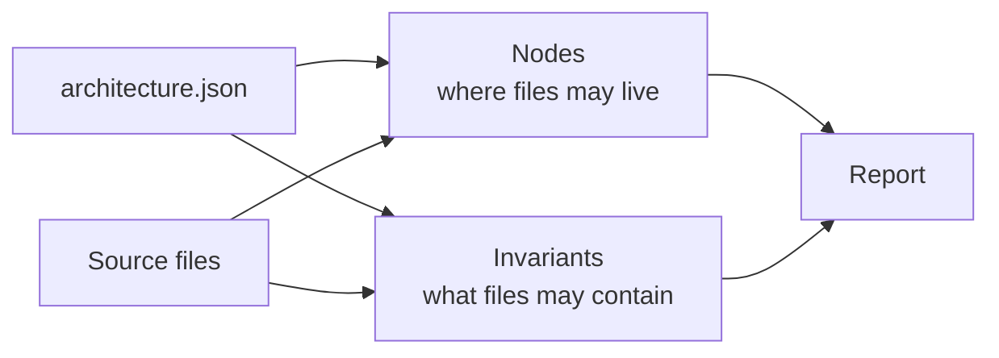

# follow-architecture

ESLint rule + CLI that validates code against a declarative architecture skeleton. The tool knows nothing about your project — everything (paths, names, rules, fixes) lives in `architecture.json`.

Two kinds of checks:

- **nodes** — where files may live and what names they may have (a folder tree with closed/open lists and per-name reports).
- **invariants** — per-file content rules: forbidden text, forbidden imports, and conditional checks driven by the file's AST.



## Quick start

```sh
bun add -D @md-code/follow-architecture
bunx follow-architecture --config architecture.json --out reports/follow-architecture.md
```

## `architecture.json`

```jsonc
{
  "aliases": { "#db": "src/db" },
  "nodes": [
    {
      "slug": "feature",
      "name": "{feature}",
      "parent": "features",
      "closed": true,
      "report": { "message": "…", "fix": "…" },
      "children": [
        "{kebab-case}.types.ts",
        "index.ts",
        { "name": "{kebab-case}.store.tsx", "forbidden": true, "report": { "message": "…", "fix": "…" } }
      ]
    },
    { "slug": "features", "name": "src/features", "children": ["feature", "db"] }
  ],
  "invariants": [
    {
      "id": "service-no-bypass",
      "where": "src/features/{feature}/**/*.service.ts",
      "forbid": [
        { "key": "client", "pattern": "new HttpClient", "report": { "message": "…", "fix": "…" }, "except": ["**/legacy/**"] },
        { "type": "imports", "key": "no-vscode", "pattern": "vscode", "report": { "message": "…" } }
      ],
      "when": "(ctx) => { /* AST-level check, returns null | true | finding | finding[] */ }",
      "except": ["src/features/shared/**/*.service.ts"],
      "report": { "message": "…", "fix": "…" }
    }
  ]
}
```

Top-level options: `files` (globs scanned by the CLI, default `**/*.ts`, `**/*.tsx`), `exts` (default `.ts`, `.tsx`, `.js`, `.jsx`), `ignores` (file globs skipped by the CLI), `ignoreDirs` (folder names the CLI does not enter, added to `node_modules`, `.git`, `dist`, `build`).

## Nodes

A **node** is a folder (or folder prefix) in the tree. Nodes reference each other by `slug` to form the tree; the path of a node is its `parent`'s path + its `name`.

- `slug` — unique name, used as `parent` by children and as `node` by invariants.
- `name` — the path segment (relative to the parent). `{name}` placeholders capture path segments (e.g. `{feature}` in a `where` of `src/features/{feature}/**` captures `orders`). Captures are available in reports of every finding inside the node.
- `parent` (optional) — the `slug` of the containing node. A node without `parent` is a root.
- `closed` (optional, default `false`) — when `true`, a file directly inside the node must match one of its `children`; otherwise it gets the node's `report`. A folder (a child that is a folder) that is not in the list is also a violation.
- `report` (optional) — the finding for "file does not belong here" (closed nodes) — see [report](#report).
- `children` (optional) — the list of allowed names inside the node. Each entry is either:
  - a **string** — a name template (`{kebab-case}`, `*`, `?` work; a name without an extension is a folder, with an extension is a file);
  - an **object** — `{ name, forbidden?, report?, description? }`. `forbidden: true` names a shape that must **never** exist (e.g. `{kebab-case}.store.tsx` in a sub-feature folder) and reports `report` when it does.

A node with no `children` is **open** — anything inside is fine. The deepest matching node wins: a file is checked against the most specific node whose path prefix matches.

## Invariants

An **invariant** is a per-file rule. Fields:

- `id` — unique name.
- `node` (optional) — a node `slug`; the invariant only runs for files that captured that node. Default `*` (all files).
- `where` (optional) — a glob the file path must match; `{name}` captures work and are available in reports. No `where` = all files.
- `except` (optional) — file globs the invariant does not apply to.
- `report` (optional) — a finding emitted for **every** matching file (a "this file, as it exists, is a problem" rule).
- `when` (optional) — a gate or an AST-level check, called as `when(ctx)` with the full file context (see [ctx](#ctx)). Return values:
  - `null` / `false` — the invariant (and its `forbid` list) is off for this file;
  - `true` — on;
  - an object or array of objects — emitted as finding(s) and the `forbid` list is skipped.
- `forbid` (optional) — array of entries, each with a `type`:
  - `type: "fileContent"` (default) — `{ key?, pattern, except?, report? }`. `pattern` is a **regex** tested against every line of the file; every matching line is a finding. `except` is a list of file globs where this entry does not apply.
  - `type: "imports"` — `{ key?, pattern, except?, report? }`. `pattern` is a **glob** (with `{name}` captures) tested against each import's **resolved path** — or the raw source for external modules that cannot be resolved. Every matching import is a finding.
  - `type: "syntax"` — `{ key?, kind, pattern?, except?, report? }`. `kind` is a ts-morph node kind name (e.g. `ImportDeclaration`, `FunctionDeclaration`, `VariableStatement`); every AST node of that kind is a finding, optionally narrowed by `pattern` (a regex tested against the node's full text). Use it when a line-based regex cannot express the rule (e.g. "no `export default`", "no function declarations").
- `children` (optional) — nested invariants; they run after the parent and inherit its captures.

`key` (on the invariant or a `forbid` entry) is a stable dedup key: findings with the same `key` are collapsed to one per file.

### `ctx`

`when(ctx)` receives, per file:

| field | meaning |
| --- | --- |
| `ctx.file` | the full ts-morph `SourceFile` — the whole AST is available (`getImportDeclarations`, `getFunctions`, `getDescendantsOfKind`, …) |
| `ctx.path` | repo-relative path (posix) |
| `ctx.basename` | file name |
| `ctx.dir` | directory (repo-relative) |
| `ctx.captures` | all `{name}` captures from the invariant's `where` and the matched node, e.g. `ctx.captures.feature` |
| `ctx.imports` | the file's import declarations: `{ source, named, defaultName, namespaceName, typeOnly, resolved }` — `resolved` is the repo-relative path after alias expansion, `null` for external modules |
| `ctx.siblings` | basenames of the other files in the same folder (the folder listing the CLI walked) — for rules like "at most N files per folder" or "no duplicated basename prefixes" |
| `ctx.arch` | the loaded architecture (nodes, invariants, aliases) |
| `ctx.enclosingFunctionName(line)` | name of the function containing the 1-based `line`, or `null` |

`when` may be a function (in a `.js` config) or a string — either a full function body (`"(ctx) => …"` / `"function(ctx) { … }"`) or an expression evaluated with `ctx` in scope — so it can live in JSON.

## report

`report` is a **field**, not a check. It is `null`, a string, a function `(vars) => string`, or `{ message, fix, level? }`. `message` is the finding text as the reader sees it; `fix` is the "instead do this" part. Both support multiline Markdown (fenced code blocks, lists, bold). The report prints them verbatim; the ESLint message is a single-line variant of `message`.

### Variables

`{name}` placeholders are substituted before the text is printed.

**From the file path** (every finding):

| variable | meaning |
| --- | --- |
| `{file}` | repo-relative path of the flagged file |
| `{basename}` | file name without directory |
| `{dir}` | directory of the file (repo-relative) |

**Captures** — any `{name}` used in a node `name`, invariant `where`, or `forbid` (imports) pattern. E.g. `{feature}` in `src/features/{feature}/**/*.service.ts` captures `orders` and is available as `{feature}` in that file's findings.

**Match context** (text-forbid findings only):

| variable | meaning |
| --- | --- |
| `{count}` | how many lines matched the pattern |
| `{plural}` | `""` if count is 1, `"s"` otherwise — for `time{plural}` |
| `{line}` | first matching line number |
| `{lines}` | all matching line numbers, comma-separated |
| `{snippet}` | the first matching line, trimmed |
| `{match}` | the exact matched text on the first line |
| `{where}` | ` in `functionName`` if the match is inside a named function, empty otherwise |

Without `report`, the tool composes a fallback from the rule's shape.

## Aliases

`aliases` maps import specifiers to paths for import resolution (e.g. `"#db": "src/db"`). Used by `type: "imports"` forbid entries and by `ctx.imports[].resolved`.

## CLI

```sh
bunx follow-architecture [options]
```

Without installing: `bunx @md-code/follow-architecture [options]`.

| flag | default | meaning |
| --- | --- | --- |
| `[cwd]` | `.` | repo root (positional) |
| `--config <path>` | `architecture.json` / `architecture.config.js` found by walking up | architecture JSON or JS module |
| `--out <path>` | print to stdout | report output |
| `--ignore <glob>` | — | extra file globs to skip (repeatable) |
| `--check` | off | exit 1 if there are findings |

The report (`--out`) groups findings by file and prints each finding as the full `message` followed by a **Fix.** section with the `fix` text.

## ESLint

The package exports a `flatConfig` factory:

```js
// eslint.config.js
const plugin = require("@md-code/follow-architecture");

module.exports = [
  {
    files: ["src/**/*.ts", "src/**/*.tsx"],
    plugins: { "md-code": plugin },
    rules: {
      "md-code/follow-architecture": ["error", {
        config: "architecture.json",
      }],
    },
  },
];
```

The package's main export is the ESLint plugin (`{ meta, rules }`). The rule is `md-code/follow-architecture`; pass the architecture file via the `config` option (repo-root-relative, or absolute).

`require("@md-code/follow-architecture/config").flatConfig(architecture, { parser, files, ignores, plugins })` is also exported as a flat-config factory. `architecture` is the object (or `{ file: "architecture.json" }` — it is resolved lazily per file so the repo root is found from the file being linted). `parser` defaults to `@typescript-eslint/parser`.
