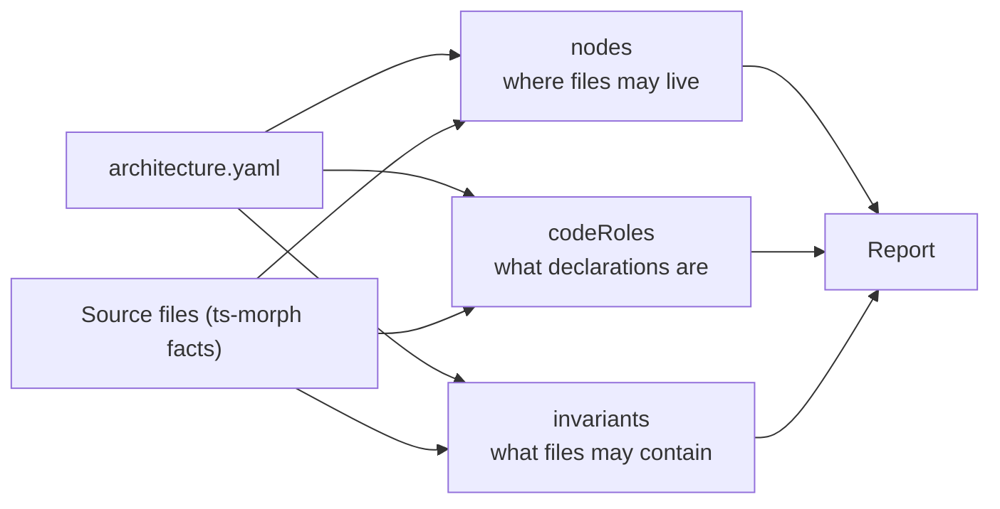

# follow-architecture

ESLint rule + CLI that validates code against a declarative architecture. The plugin knows nothing about your project — everything (paths, names, rules, fixes) lives in `architecture.yaml`.

The plugin is 100% generic. It collects **raw facts** from the AST via ts-morph and evaluates **filters** (Keystone-GraphQL-filters style) against them. There are no named rule kinds and no semantic predicates inside the plugin — all rule semantics live in the YAML.

Four entities, each with its own section (and folder in this repo) — they do not mix:

| entity | YAML key | folder | answers |
| --- | --- | --- | --- |
| aliases | `aliases` | [aliases.js](aliases.js) | which import sources map to which paths |
| nodes | `nodes` | [nodes/](nodes) | where files may live and what names they may have |
| codeRoles | `codeRoles` | [code-roles/](code-roles) | what a declaration *is* (store model, factory, pure function, …) |
| invariants | `invariants` | [invariants/](invariants) | what a file may contain |



## Quick start

```sh
bunx follow-architecture --config architecture.yaml --out reports/follow-architecture.md
# exit 1 when findings exist (CI):
bunx follow-architecture --config architecture.yaml --check
```

As an ESLint rule (flat config):

```js
const { flatConfig } = require("@md-code/follow-architecture");
module.exports = [...flatConfig(require("./architecture.yaml"))];
```

## `architecture.yaml`

```yamlc
# import-source → repo-relative path (for resolving imports in facts)
aliases:
  backend: apps/backend

# folder tree: where files may live
nodes:
  - slug: backend          # unique id, referenced by parent / children
    name: apps/backend     # path segment (or prefix); {name} placeholders capture segments
    parent: root
    closed: true           # a file directly inside must match one of children
    report:                # finding text for "file does not belong here"
      message: "…"
      fix: "…"
    children:
      - index.ts
      - "{kebab-case}.ts"  # name template; {kebab-case} matches kebab-case text
      - name: "{kebab-case}"
        forbidden: true    # a shape that must NEVER exist
        report: { message: "…", fix: "…" }

# what a declaration is: a LIST of roles, first `infer` filter that matches wins
codeRoles:
  - slug: storeModel
    name: store model
    # Accessors that REACH this role (mobx-state-tree's getRoot/getParent).
    # Property-access chains rooted at one become the `scopeAccesses` fact.
    # Per-role: different roles may be reached through different accessors.
    scopeAccessors:
      - getRoot
      - getParent
    infer:
      - kind: { equals: VariableDeclaration }
      - initializer:
          kind: { in: [CallExpression, NewExpression] }
          origin: { equals: "t.model" }
    assert:
      structure:
        forbidden:
          - kind: { equals: ClassDeclaration }
      actions:
        CallExpression:
          allow:
            pureFunction: { max: 50 }   # per-role call-count bounds

# what a file may contain
invariants:
  - id: no-any
    where: ["**/*.ts"]          # minimatch globs; empty/omitted = all files
    except: ["**/*.test.ts"]    # globs the invariant does not apply to
    when:                              # optional gate: a plain filter over the file facts
      roles: { some: { equals: orchestrator } }  # e.g. "a role is present"
    forbid:                     # a finding when a filter MATCHES the facts
      - descendants:
          some:
            kind: { equals: AnyKeyword }
    must:                       # a finding when a filter DOES NOT match
      - path.folderFiles:
          contains: store.ts
    report: { message: "…", fix: "…" }
```

The yaml describes **what the code must look like** — it carries no scan scope. Where the tool looks is a tool concern, set separately:

- **CLI** — `--files <glob>` (files to scan; default `**/*.ts`, `**/*.tsx`), `--ignore <glob>` (repeatable, file globs skipped).
- **ESLint rule options** — `{ config, ignoreDirs?, ignores? }`: `ignoreDirs` (folder names not entered, added to the built-in `node_modules`, `.git`, `.vscode-test`, `out`, `dist`, `build`, `coverage`) and `ignores` (file globs skipped).
- File extensions are fixed: `.ts`, `.tsx`, `.js`, `.jsx`.

## Nodes

A **node** is a folder (or folder prefix) in the tree. Nodes reference each other by `slug`; the path of a node is its `parent`'s path + its `name`.

- `slug` — unique name, used as `parent` by children.
- `name` — the path segment. `{name}` placeholders capture path segments (e.g. `{kebab-case}` in `apps/backend/features/{kebab-case}`) and are available in reports.
- `parent` (optional) — the `slug` of the containing node. No `parent` = root.
- `closed` (optional, default `false`) — when `true`, a file directly inside must match one of its `children`; otherwise it gets the node's `report`.
- `report` (optional) — the finding for "file does not belong here".
- `children` (optional) — allowed names inside the node. Each entry is either:
  - a **string** — a name template (`{kebab-case}`, `*`, `?` work; a name without an extension is a folder, with an extension is a file);
  - an **object** — `{ name, forbidden?, report? }`. `forbidden: true` names a shape that must **never** exist.

A node with no `children` is **open** — anything inside is fine. The deepest matching node wins.

Nodes may also carry a `roles` block: `required: [role, …]` (the file must contain a candidate of each role) and `forbidden: [role, …]` (the file must not contain a candidate of that role).

## Code roles

A **candidate** is any function-like node (declaration, expression, arrow, method, accessor) or variable declaration. For each candidate the plugin collects raw facts (below) and assigns the **first** role (in YAML declaration order) whose `infer` filter matches.

- `infer` — an AND-list of filters on the candidate's facts. A role without `infer` is never inferred (it can still be referenced by `when` gates and `assert`).
- `assert` (optional) — checked for every candidate that got this role:
  - `structure.forbidden` / `structure.required` — filters on the candidate's `descendants`;
  - `actions.<DescendantKind>` — `{ deny?, allow?, unresolved? }` on the candidate's calls: `deny: all` forbids the kind entirely, `allow: true` allows it, `allow: { <role>: { min?, max? } }` bounds how many calls may target candidates of that role.

## Invariants

An **invariant** is a per-file rule. Fields:

- `id` — unique name.
- `where` (optional) — list of glob patterns the file path must match (same placeholders as node children: `{kebab-case}`, `{camelCase}`, `{PascalCase}`, `{name}` → `[^/]+`). Empty/omitted = all files.
- `except` (optional) — list of globs the invariant does not apply to.
- `when` (optional) — a gate: a plain filter over the file facts (the same filter language as `forbid`/`must`, run through the shared `matches` engine). The file facts include `roles` (the flat list of role names present) and `candidates` (the role-enriched candidate facts, each carrying `role`, `parentRole`, and `calls[].targetRole`). Example: `when: { roles: { some: { equals: orchestrator } } }` gates on "an orchestrator is present"; `when: { candidates: { some: { role: { equals: pureFunction }, parentRole: { equals: orchestrator } } } }` gates on "a pure function nested in an orchestrator". Omitted = no gate.
- `forbid` (optional) — list of filters; a finding when a filter **matches** the file facts. A filter whose keys are not file-level facts is applied to each **candidate** instead, and the matching candidate supplies the `{what}` / line of the finding.
- `must` (optional) — list of filters; a finding when a filter does **not** match.
- `assert` (optional) — a single filter; a finding when it does not match.
- `report` (optional) — the finding text. An invariant with a `report` and no checks of its own is its own finding (it applies to every matching file).

## The filter engine

Every `infer` / `forbid` / `must` / `assert` / `where`-by filter uses one grammar ([utils/queries.js](utils/queries.js)). A filter is:

- an **object of entries** — AND of all entries;
- a **list of filters** — AND of all sub-filters;
- `null` / omitted — always passes.

Each entry is either an **operator** or a **field** of the item (`{ kind: { in: […] } }` → item's `kind` must pass `{ in: […] }`).

Scalar operators: `equals`, `not`, `lt`, `lte`, `gt`, `gte`, `in`, `notIn`, `contains`, `startsWith`, `endsWith`, `isSet`, `setEquals`, `globMatches`.

List operators (list values only; a missing/non-list field simply fails the filter): `length`, `every`, `some`, `none`, `where` (`{ filter, by }` — narrows the list, then applies `by`).

Composition: `or` — a list of filters; passes when **any** sub-filter passes.

`$`-prefixed values reference another fact in scope: `{ equals: "$parentName" }` compares the field to the candidate's `parentName`.

## Facts

**File facts** (the target of file-level invariant filters): `lines`, `imports` (`[{source, typeOnly, named, line, defaultName?, namespaceName?, resolved}]` — `named` carries local binding names, `resolved` is the repo-relative path after alias expansion), `exports`, `path` (everything about the file's LOCATION in the repo tree, queryable by dot-path: `path.dir`, `path.fileName`, `path.filesPerFolder`, `path.folderFiles`, `path.subfolders`, `path.sharedPrefixes`), `scopeAccesses` (property-access chains rooted in a config-named accessor, e.g. `getRoot(...)`), `descendants` (every meaningful node at every depth: `{kind, line, name, snippet, depth, …}` plus `isUnknownCast` on `as` expressions and `members` on object literals), `candidates` (the function-like / variable-declaration facts, each role-enriched), `roles` (the flat list of role names present).

**Candidate facts** (one entry per function-like / variable declaration): `kind`, `name`, `line`, `role`, `parentName`, `moduleScope`, `exported`, `mutable`, `lines`, `descendants`, `returns` (`[{kind, exprKind, origin, members}]` — `kind` is `ReturnStatement`/`ExpressionBody`, `exprKind` is the ts-morph kind of the yielded expression or null, `origin` is the leftmost identifier of the chain (`t.model` in `t.model({...})`), `members` is raw `[{name, kind, isFunction}]` for an object-literal value), `hasReturn`, `initializer` (same `{kind, exprKind, origin, members}` shape — null for non-variable declarations), `calls` (one unified entity for every call shape: `{kind, origin, action, module, forwardsAllParams, targetRole}`), `assignments` (`[{kind, targetName, local}]`), `declarations`, `parameters`, `mutatedParams`, `emptyBody`, `bodyStatements`.

`nested` is set on function-like / loop descendants: `true` when nested inside another function-like node.

## Report

`report` is `null`, a string, or `{ message, fix }`. Both fields support multiline Markdown. `{name}` placeholders are substituted: path vars (`{file}`, `{basename}`, `{dir}`), captures from `where` / node names, and match context (`{what}` — the matched candidate's name, `{snippet}`, `{lines}`, `{filesPerFolder}`, …).

## Tests

```sh
npx vitest run
```
